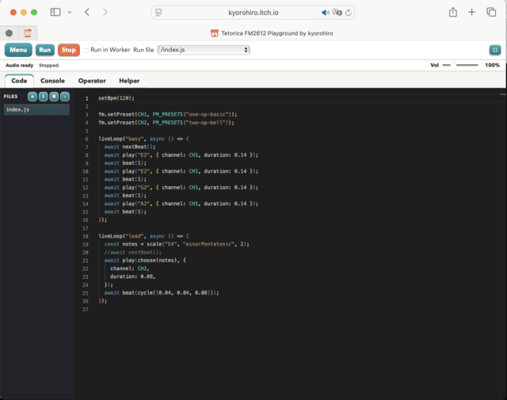

# Tetorica — 多彩なレトロ音源をJavaScript・WebAssembly・C/C++で扱う

[English](README.md) | [日本語](README.ja.md) | [AI/SI](READMD.ai.md)

Tetoricaは、多数のレトロ音源チップを学び、演奏し、自分のアプリへ組み込むためのツールキットです。
Yamaha FM、Sega PSG、ゲームボーイ／NES APU、SNES S-DSP、PlayStation SPU、Saturn SCSP、C64 SIDなどに対応しています。
[ブラウザーのPlaygroundですぐに試せます](https://kyorohiro.github.io/hello_ymfm_wasm/playground/index.html)。インストールは不要です。

自作アプリやゲームには、**[npmパッケージ`tetorica-fm2612`](https://www.npmjs.com/package/tetorica-fm2612)**を使えます。
音符・プリセット・音源固有の音作りを扱う**高水準Synth API**に加え、
レジスター／RAM／PCMを扱う**低レベルAPI**、TypeScript型定義、**ビルド済みWASM**を提供します。
再利用可能な**Native C/C++コア**とビルド手順は、
[`tetorica-soundchip-native`](https://github.com/kyorohiro/tetorica-soundchip-native)で提供しています。

## プロジェクトの目標

YM2612から始まった次の4つの目標を、多様な音源チップへ広げながら取り組んでいます。

- YM2612チップを理解すること。
- 誰でもYM2612チップを理解できるドキュメントを作ること。
- ブラウザーアプリやゲームにYM2612の音声を組み込む方法を、誰でも理解できるドキュメントを作ること。
- 古いゲーム音楽や音源チップの技術を文化的な遺産として残すこと。保存・再生に加え、今の人たちが読み解き、調査し、学び、再構成できる形を目指します。

配布物も読みやすく、改造しやすい形を保ちます。自作のJavaScript／CSSは
ミニファイ・難読化せず、元のモジュール分割・コメント・名前を残して配布します。
Tauri版も同じ方針です。生成されたWASMとローダーには、対応する元ソースと
再ビルド手順を添えます。

## Playground

[Playgroundを開く](https://kyorohiro.github.io/hello_ymfm_wasm/playground/index.html)

[](https://kyorohiro.github.io/hello_ymfm_wasm/playground/index.html)

<a id="機能対応状況"></a>

## やりたいことから選ぶ

| やりたいこと | 入口 |
| --- | --- |
| インストールせずに試したい | [ブラウザー版ホーム](https://kyorohiro.github.io/hello_ymfm_wasm/index-ja.html) · [itch.io](https://kyorohiro.itch.io/) |
| ビルド済みWASMと低レベルJavaScriptが欲しい | [npmの`tetorica-fm2612`](https://www.npmjs.com/package/tetorica-fm2612) · [API一覧](packages/fm2612/README.md#api-entry-points) · [WASMとソースの配置](tetorica_src/runtime/README.md) |
| npmの高水準APIで音符・プリセット・音声再生を扱いたい | [Synth／Transport API一覧](packages/fm2612/README.md#api-entry-points) · [Web／Nodeの実行例](https://github.com/kyorohiro/tetorica-fm2612-examples) |
| アプリにライブコーディングを組み込みたい | [Playground Runtime](tetorica_src/runtime/README.md#playground-runtime) |
| 音楽ファイルを調べ、音色や楽譜を取り出したい | [VGM Analyzer](https://kyorohiro.github.io/hello_ymfm_wasm/vgm_analyzer/index.html) · [`tetorica-vgm` CLI／Node API](packages/vgm/README.md) |
| C／C++コアを使い、NativeアプリやPluginを作りたい | [`tetorica-soundchip-native`](https://github.com/kyorohiro/tetorica-soundchip-native) · [SPU Pluginのソース／Preview](https://github.com/kyorohiro/tetorica-spu-plugin) |
| エディターに仮想ファイル・Shell・Gitを付けたい | [`tetorica-virtual-files`](packages/virtual-files/README.md) · [npm](https://www.npmjs.com/package/tetorica-virtual-files) |
| 実装範囲と制限を確認したい | [機能対応状況](docs/feature-status.md) · [Analyzer音源対応表](docs/vgm_analyzer/support.html) · [チップ別の記録](Memo.md) |

<a id="ブラウザーで試す"></a>
<a id="itchioで試す"></a>

## ブラウザーツール

| ツール | できること |
| --- | --- |
| [Playground](https://kyorohiro.github.io/hello_ymfm_wasm/playground/index.html) | JavaScriptライブコーディング、レジスター操作、音楽API、サンプル編集、FILES／Shell。音源modeを選んで使います。 |
| [FM2612 Synth](https://kyorohiro.github.io/hello_ymfm_wasm/synth/index.html) | FMオペレーター／エンベロープ編集、鍵盤試奏、VGM音色取込、TFI／VGI編集。PSGタブでは矩形波3CHのラウンドロビン／Noiseを演奏し、実機の減衰値と固定／Tone 3連動のNoise clockを操作できます。Software Envelope（初期値Off）でADSRも設定でき、実機の段階的な音量をソフトウェア制御する機能だと明示しています。PSG音色は読みやすい`.psg.json`としてFiles／Cassetteへ保存でき、Sync／Revertとローカル復旧に対応します。FM／PSGの切替では各音色と編集ファイルを保持します。元のVGM／VGZをFiles／Cassetteに保存し、メガドライブ／Mega CD／32Xの模範演奏（YM2612＋Sega PSG＋DAC＋RF5C164＋PWM）を再生できます。シークバーを離すと移動し、再生／Pauseを保って移動先のLive表示・試奏へ切り替わります。Seek cacheは既定OnでMixから切替可能。同曲の再訪には上限付きのメモリ内checkpointを使います。YM2612／PSGタブで曲中のCH1〜CH6、PSG Tone 1〜3／Noiseを切り替えてLive表示できます。PSGは聴こえる位置の実機設定を表示し、Software EnvelopeはOffです。Pause中に選択CHを試奏し、Copyで元音色を残して新しいSynth音色へ取り込めます。OP1〜OP4の行番号で、通常音色も実機のKey On／Off（全Offを含む）を選べます。押しっぱなしの切替でも他のOPを再発音しません。Files／Cassette・Looper／Event Recも発音OPとCH3の音程比を保持し、特殊モードはCH3固定です。VGM再生中は録音を停止・無効化します。Live（既定On）は聴こえる位置へ追従し、Offでは表示を固定。Mix内で各CHのMuteとYM2612／Sega PSG／Mega CD PCM別のVolume（0〜380%）を操作できます。100%は音源出力1倍で、初期値・Resetは共通System補正、PWMも共通の固定基準へ揃えています。変更ハイライトは既定Onです。 |
| [SPU Synth](https://kyorohiro.github.io/hello_ymfm_wasm/synth-spu/index.html) | PlayStationのサンプル音源、PCMお絵描き、ADSR、PMON、Noise、SPU Reverb、PSF／VAB音色抽出。 |
| [DMG Synth](https://kyorohiro.github.io/hello_ymfm_wasm/synth-dmg/index.html) | Game Boy DMGの1台のAPUでPulse／Wave／Noiseを演奏。ラウンドロビン鍵盤、波形描画、プリセット、JavaScript出力。英語UI。[ガイド](docs/synth-dmg/README.md)。 |
| [2A03 Synth](https://kyorohiro.github.io/hello_ymfm_wasm/synth-2a03/index.html) | Pulse／Triangle／Noise／DMC／FDSを鍵盤で試奏。実機EnvelopeとPulse／Triangle／Noiseのcounter gate・内部状態表示、DMC目標波形の描画・bit編集・DAC可視化・Undo／Redo、FDS波形・変調table編集、VGM／VGZ音色・サンプル抽出、DPCM書出・プリセット保存・JavaScriptコピー。英語UI。[ガイド](docs/synth-2a03/README.md)。 |
| [HuC6280 Synth](https://kyorohiro.github.io/hello_ymfm_wasm/synth-huc6280/index.html) | PC Engineの波形メモリーPSG、Noise、LFOペア、波形描画、音声の5bit DDA PCM再生、ソフトウェアADSR、VGM／VGZのWave／Noise／LFO／DACストリーム・直接DAC PCM抽出、プリセット／JavaScript出力。英語UI。[ガイド](docs/synth-huc6280/README.md)。 |
| [S-DSP Synth](https://kyorohiro.github.io/hello_ymfm_wasm/synth-snes/index.html) | SNESの8声BRR／hardware Noise、ADSR／GAIN、共有Echo／FIRを操作。最大4音のhardware PMONはWave／BRR変調音源と独立tuning／Envelopeに対応し、同じcanvasで編集・previewできます。SPC音色と任意の単純PMON pair／Echo取り込み、両sample対象へのWAV／raw BRR読込、両音源を含むv5保存（strict v1〜v4移行）・既存APIのJavaScript出力に対応。[ガイド](docs/synth-snes/README.md)。 |
| [SCSP Synth](https://kyorohiro.github.io/hello_ymfm_wasm/synth-scsp/index.html) | 実験的なSaturn PCM音源、波形描画／読込、エンベロープ、LFO。 |
| [SID Synth](https://kyorohiro.github.io/hello_ymfm_wasm/synth-sid/index.html) | 6581／PALの8580 Previewを切り替えて、3声鍵盤、Pulse幅、hardware ADSR、共有filter、1音のSync／Ringペアを試奏。SIDを直接開き、曲を試聴して今のvoiceをこの鍵盤へ取り込めます。v2 presetはモデルを保存し、従来のv1は6581として読込。Playerのsnapshotにも対応し、波形未選択の変調元を持つ独立ペアも取込・編集・可読JavaScript出力できます。[ガイド](docs/synth-sid/README.md)。 |
| [C64 SID Playground](https://kyorohiro.github.io/hello_ymfm_wasm/playground/index.html?mode=c64) | 3声・ADSR・Sync／Ring・共有filterをMain／Workerの可読コードから操作し、SIDタブで適用済み状態を確認。標準SIDは6581で、PALの8580 Previewを独立した追加インスタンスとして作成できます。[ガイド](docs/sid.md)・[6581の独立filterラボ](docs/playground/sid-lab/README.md)。 |
| [SID Player](https://kyorohiro.github.io/hello_ymfm_wasm/sid-player/index.html) | 対応するPALのPSID v2・RSID v2を、Auto／6581／8580 Previewで再生し、3声と共有filter設定を表示。単一波形のvoiceや独立したSync／Ringペアの瞬間設定をSID Synth用presetへ取り込めます。VBI／CIA割り込みをC64機械で動かし、安全なdriver RAMと限定内蔵環境または手元のROMを使用します。Direct VBIは6581で選択可能。自作デモ・可読ソース付きです。[使い方・制限](docs/sid-player/README.md)。 |
| [VGM Analyzer](https://kyorohiro.github.io/hello_ymfm_wasm/vgm_analyzer/index.html) | 再生、音源／チャンネルの観察、対応するサンプル／FM音色の抽出、参考採譜。 |
| [MIDI Playground](https://kyorohiro.github.io/tetorica-midi-playground/index.html) | 別プロジェクトのmacOS MIDIライブコーディングアプリ。[ソースと配布版](https://github.com/kyorohiro/tetorica-midi-playground)。 |
| [YM2612入門](https://kyorohiro.github.io/hello_ymfm_wasm/introductions/index-ja.html) | JavaScriptを通じてFM合成とチップを学ぶ。 |

[Playgroundの画面](docs/tetorica_fm2612_playground_screen_shot.png) ·
[ブラウザー操作／SPC変換の詳細](docs/browser_workflows.ja.md) ·
[Runtime組み込みデモ](https://kyorohiro.github.io/hello_ymfm_wasm/demos/playground_runtime.html)

## どんなゲーム機・形式に対応している？

対応範囲は、ゲームタイトルの一覧ではなく、**音源チップと入力形式**で管理しています。
このプロジェクトは音声のためのツールで、ゲームROMの実行やゲーム機全体のエミュレーションは行いません。
次は代表的な機種です。その機種のすべてのゲーム音楽や音色を復元できるという意味ではありません。

| 機種・音源系統 | 主な対象 |
| --- | --- |
| メガドライブ、メガCD、32X | YM2612＋Sega PSG、RF5C164 PCM、PWM。VGM解析と音源操作。CD-DAは独立した音声ソースです。 |
| PC-88／PC-98、Neo Geo | YM2203／YM2608／YM2610/B。FM、SSG、各音源のリズム／ADPCM。 |
| X68000、アーケードFM／PCM | YM2151、OKIM6258／OKIM6295、Sega PCM。VGMの併用構成には制限があります。 |
| Master System／Game Gear、MSX、AdLib／OPL | Sega PSG、AY8910、YM2413、Y8950、SCC／SCC+、OPL／OPL2／OPL3／OPL4。 |
| ファミコン／NES＋FDS、ゲームボーイ | APU音源の操作と、対応するVGMの再生／解析。リージョン・拡張の条件は音源ごとに異なります。 |
| PCエンジン／CD-ROM² | HuC6280、MSM5205 ADPCM、CD-DA API。対応するVGMの再生／解析。 |
| スーパーファミコン／SNES | SPCの曲再生、BRR音色、実験的な音程解析／編集可能なJavaScriptへの変換。 |
| PlayStation 1 | SPU音源の操作、PSF1／MiniPSFセットからのVAB静的抽出。**PSFの曲再生には未対応**です。 |
| セガサターン | 実験的なSCSP音源／レジスターAPI。**SSFの曲再生・68000実行には未対応**です。 |
| Commodore 64 | npm 0.2.37以降は`SidCore`・`Sid8580Core`・`SidSynth`を提供します（[利用例](packages/fm2612/README.md#c64-sid-6581-and-8580-preview)）。実験的な6581／PALの8580 Preview音色、共有filter、Main／Worker API。Playgroundの標準SIDは6581で、8580は独立した追加インスタンスを作成します。[ブラウザーSID Player](docs/sid-player/README.md)はPAL・単一SIDのPSID VBI／CIA・RSID v2を**6581／8580 Preview**で再生。Direct VBIは6581で選択可能です。既存[参照CLI](docs/sid-reference.md)は変更せず比較WAVを出力。NTSC／複数SID・正確なvolume-DAC digiはPlayerの対応範囲外です。ROM依存／BASIC起動はユーザーROMが必要で実firmware互換性は追加確認が必要です。C64 ROMは同梱しません。 |
| Atari 8-bit、WonderSwan | POKEYとWonderSwan音源。ファイル／解析の制限はAnalyzer対応表を参照してください。 |

| 入力 | 対応する使い方 |
| --- | --- |
| VGM／VGZ | Browser AnalyzerとCLIで再生／調査。チップ別に音色・サンプル・楽譜を出力。一部のPlayground modeでは編集可能なJavaScriptへ変換できます。 |
| S98 | 対応する単一Yamaha音源構成。圧縮S98・複数デバイスは対象外です。[入力仕様](CLI.md#s98-input-and-source-documents)を確認してください。 |
| SPC／BRR | SPCのCPU／DSP再生と解析、独立したBRR音色の作成。[変換仕様と制限](docs/browser_workflows.ja.md)。 |
| VAB、または対応するVH＋VB | Sony標準v6／v7のバンク。Playground／SPU SynthでToneを選び試奏できます。 |
| PSF1／MiniPSF＋PSFLib | ファイルまたはフォルダーを指定し、依存ライブラリーを解決して認識できるVABを静的抽出。ゲームドライバー実行・PSF2・すべての独自音色形式の復元には未対応です。[SPU取込ガイド](docs/synth-spu/README.md#ps1-sound-banks)。 |
| 音声・音色ファイル | PCM作成とチップ別のサンプル変換。TFI／VGI、OPM、SBI、DX7 SysExはそれぞれ取込／出力の対応範囲が異なります。 |

特定のVGMは`npx tetorica-vgm support song.vgz --json`で確認できます。
併用構成、外部ROMの要否、Exportの制限は[Analyzer対応表](docs/vgm_analyzer/support.html)を参照してください。
再生・音色編集・採譜は別の機能です。採譜は編集用の参考データで、原譜の復元ではありません。

## どんなSoundChipを使える？

| 系統 | 含まれるコア／API |
| --- | --- |
| Yamaha OPN | YM2203、YM2608、YM2610／YM2610B、YM2612、YM3438、YMF276、YMF288 |
| Yamaha OPM／OPP | YM2151／YM2164 |
| Yamaha OPLL／OPL | YM2413、YM3526、YM3812、Y8950、YMF262、YMF278B |
| PSG・波形メモリー・ゲーム機音源 | AY-3-8910／YM2149、Sega PSG、Game Boy APU、NES APU＋FDS、HuC6280、K051649／K052539、POKEY、WonderSwan |
| PCM／ADPCM | RF5C164、Sega PCM、OKIM6258、OKIM6295、MSM5205 |
| 独立した音源／プレイヤー | [PS1 SPU](docs/ps1_spu.md)、[Saturn SCSP](docs/scsp.md)、SNES S-DSP／SPC700、MSFA DX7、[実験的なSID 6581／8580 Preview](docs/sid.md) |

npmルートの`createSoundChip()`、Playgroundの`createSoundChip()`／`useSoundChip()`、
独立したクラス、高水準Synth APIは、入口と対応範囲が異なります。
例えばPS1とSCSPはnpmの専用subpathからimportします。Playgroundの音源名を、そのままnpmルートのfactoryへ渡せるわけではありません。
[用途別API一覧](packages/fm2612/README.md#api-entry-points)で選んでください。
YM2612の標準コアはymfmです。任意で使えるNuked-OPN2には別のライセンスが適用されます。

<a id="download"></a>
<a id="npmjs-package"></a>
<a id="tetorica-fm2612"></a>
<a id="wasmと低レベルjavascriptを入手する"></a>

## npm API・WASM・Nativeコアを使う

```sh
npm install tetorica-fm2612
```

npmパッケージ`tetorica-fm2612`は、多数の音源チップを含みます。
音符・プリセット・音色には[高水準Synth API](packages/fm2612/README.md#api-entry-points)、
レジスター／RAM／PCMには低レベルAPIを使えます。操作できる項目とimport先は音源ごとに異なります。

パッケージにはES modules、TypeScript型定義、ビルド済みの`generated/*_wasm.js`ローダーと
対応する`.wasm`、ソースアーカイブ、コンポーネントの通知を含みます。
ブラウザーとNode.jsで同じ直接PCM生成コアを使えます。Node.jsは22以降が必要です。

| 配布物・ソース | 場所 |
| --- | --- |
| npmのimportとアセットURL | [パッケージREADME](packages/fm2612/README.md)。`runtimeAssetUrl()`とWASMの独自ロード方法も記載。 |
| ソースcheckout | [JavaScriptソースの案内](tetorica_src/runtime/README.md)、ビルド済みローダー／WASMの全一覧は[`tetorica_src/runtime/generated/`](tetorica_src/runtime/generated/)、Node音声は[`tetorica_src/node/`](tetorica_src/node/README.md)。 |
| 単独で使えるWeb Runtime ZIP | [生成手順とファイル名](README_RELEASE.md)。Runtime、生成済みアセット、通知を同梱します。 |
| C／C++と再現可能なWASMビルド | [Native SDK](https://github.com/kyorohiro/tetorica-soundchip-native)と[固定SDKのビルドガイド](docs/building_ym2612_wasm.md)。 |

## 使用例

低レベルAPIでYM2612のFM 1チャンネルを設定し、短いWAVをメモリー上に生成する例です。
直接レンダリングなのでスピーカーや音声デバイスは開きません。Node.js 22以降のES module、
またはnpm importを解決するブラウザー向けバンドラーで使えます。

```js
import {createSoundChip, encodeWav} from 'tetorica-fm2612';

const chip = await createSoundChip('ym2612');
try {
  chip.reset();
  for (const offset of [0, 4, 8, 12]) {
    chip.writeRegister(0x30 + offset, 0x01); // オペレーターの倍率。
    chip.writeRegister(0x40 + offset, offset === 12 ? 32 : 127);
    chip.writeRegister(0x50 + offset, 0x1f); // 速いAttack。
    chip.writeRegister(0x60 + offset, 0x00);
    chip.writeRegister(0x70 + offset, 0x00);
    chip.writeRegister(0x80 + offset, 0x0f);
  }
  chip.writeRegister(0xb0, 0x07); // Algorithm 7。1つのcarrierだけを鳴らす。
  chip.writeRegister(0xb4, 0xc0); // 左右へ出力。
  chip.writeRegister(0xa4, 0x24); // BLOCK／FNUM上位。およそA4。
  chip.writeRegister(0xa0, 0x3b); // FNUM下位。
  chip.writeRegister(0x28, 0xf0); // チャンネル1のKey On。
  const pcm = chip.generateStereo(4096);
  chip.writeRegister(0x28, 0x00); // Key Off。
  const wav = encodeWav({...pcm, sampleRate: chip.sampleRate()});
  console.log(wav.byteLength); // このバイト列を保存、またはPCMを自分の出力へ渡す。
} finally {
  chip.dispose();
}
```

音名やプリセットで操作する場合は各音源のSynthヘルパーを使います。ブラウザーで音を鳴らすには
ユーザー操作後にAudioWorklet Transportを開始します。Nodeの音声デバイス出力は任意のAudifyで扱います。
[Web／Nodeの実行用プロジェクト](https://github.com/kyorohiro/tetorica-fm2612-examples)、
[ローカルNode例](tetorica_examples/nodejs/README.md)、[Playgroundの例](docs/playground/examples/README.md)、
[パッケージのブラウザー／PCM例](packages/fm2612/README.md)も参照してください。

<a id="tetorica-vgm"></a>

ファイル解析とExportには`tetorica-vgm`をインストールするか、直接実行します。

```sh
npx tetorica-vgm analyze song.vgz --json
npx tetorica-vgm render song.vgz --output song.wav
npx tetorica-vgm export song.vgz --format musicxml --output song.musicxml
```

[CLI／Node APIリファレンス](CLI.md) · [音色Exportの例](docs/browser_workflows.ja.md#cliで音色と楽譜を出力する)

## 自分のプロジェクトで再利用する

レジスター／RAM／PCMなら低レベルチップ、音楽的な操作ならSynthヘルパー、音声出力ならTransport、
ライブコーディングならPlayground Runtimeと、必要な層だけを使えます。
npmの音声パッケージにはPlayground／Synthの編集画面全体は含まれません。
`tetorica-virtual-files`は、仮想ファイル／Shell／Gitを独立して使えるパッケージです。
Native SDKと[SPU DAW Plugin](https://github.com/kyorohiro/tetorica-spu-plugin)は、
C／C++への組み込み例を別プロジェクトとして提供します。デスクトップの対応環境はプロジェクトごとに異なります。

EmscriptenとPython 3を用意し、例えば`sh scripts/build_ym2612_wasm.sh`を実行するとソースからビルドできます。
レシピは`third_party/`の固定SDKを検証して使います。
[ビルド／SDK更新／分離したアセット検証の手順](docs/building_ym2612_wasm.md)。

## ライセンスとクレジット

独自ファイルとymfm由来のコンポーネントは、特記がない限り[BSD-3-Clause](LICENSE)です。
適用されるライセンスに従って改変・再利用できます。著作権表示を維持し、使用するコンポーネントが
求める通知やソースを配布物に含めてください。
全体が一律BSDではありません。SNES-SPCと任意のNuked-OPN2は**LGPL-2.1-or-later**、
MSFA DX7と関連するNESコンポーネントは**Apache-2.0**です。Sonic Piサンプルは**CC0-1.0**です。
ゲームROM、ゲーム音楽、PSFセット、市販音色バンクの利用許諾を、このプロジェクトが与えるものではありません。

[クレジットと実装参考資料の全文](docs/attribution.ja.md)に、上流の著作者、確認したリビジョン、
UIの着想、素材の由来を残しています。[コンポーネント別の通知](docs/licenses/)、
[DX7の通知](docs/licenses/tetorica-msfa-dx7-wasm/THIRD_PARTY_NOTICES.md)、
再配布するRuntimeに含まれるソース／ライセンスも確認してください。

<a id="リンク"></a>

## リポジトリーの構成と参考リンク

| ディレクトリー・資料 | 内容 |
| --- | --- |
| [`tetorica_src/`](tetorica_src/README.md) | 共有JavaScript Runtime、Node／CLIアダプター、Native音声エフェクト、WASMブリッジ。 |
| [`docs/`](docs/index-ja.html) | 公開ツール、生成済みWASM、ガイド、使用例、ライセンス、詳細な設計記録。 |
| [`packages/`](packages/) | 音源、VGMツール、仮想ファイルのnpm manifest／README。 |
| [`tetorica_examples/`](tetorica_examples/README.md) | Tetorica独自のNode／Browser／C++実行例。 |
| [`src/`](src/)、[`examples/`](examples/README.md) | 元のディレクトリー配置を維持する、ymfm由来のコアと利用例。 |
| [`third_party/`](third_party/)、[`scripts/`](scripts/) | 固定した上流／SDKのソース、ビルド、パッケージ生成／検証スクリプト。 |
| [機能対応状況](docs/feature-status.md)、[Memo](Memo.md)、[CLI](CLI.md) | 実装範囲、チップの記録、解析APIの詳細。 |
| [リリース手順](README_RELEASE.md)、[itch.io ZIPの検証](docs/itch_web_release.md) | 開発者向けのビルド／配布手順。 |

ハードウェア・上流の参考資料：[ymfm](https://github.com/aaronsgiles/ymfm)、
[MAME](https://www.mamedev.org/)、[VGM仕様](https://vgmrips.net/wiki/VGM_Specification)、
[SMS Power!](https://www.smspower.org/)、[libymfm.wasm](https://github.com/h1romas4/libymfm.wasm)。
[参考リンクの全一覧](docs/attribution.ja.md#リンク)にはYM2612レジスター資料や関連プロジェクトも掲載しています。
