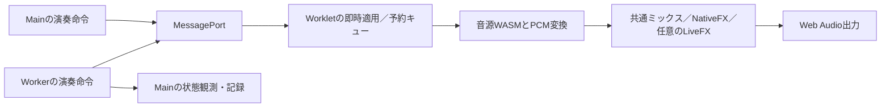

# Performance Audit — リアルタイム音声処理

実施日：2026-10-21。依頼：[aaa_daily01.md](aaa_daily01.md)。
対象コミット：`05342b77b089962a6f13c0a473e88d1cf16ec5f3`。

**以下は実装前の監査記録。監査では調査・一時的な比較実験・報告のみ行い、本番コード、WASM配布物、API、音色、チャンネル管理は変更していない。**
比較実装は診断用の別インスタンス／一時モジュール／一時ビルドに限定した。
今回の結果から、過去のノイズ原因や解消理由は推定しない。
監査後の実装指示による変更は、末尾の「P1実装追記」に記録する。

## 結論と優先順位

最初に検討する価値が高いのは、**HuC6280のPCMコピー方法**と、
**LiveFXの出力検証ループ**。どちらも検証や音量演算を残したまま、
Node/V8で大きな一時割り当て削減を確認した。比較したPCMはバイト単位で一致した。

| 順位 | 改善候補 | 効果が出る条件・測定上の根拠 | 変更リスク | 優先度 |
|---|---|---|---|---|
| 1 | HuC6280のmapped `Float32Array.from`を添字コピーへ | 同一realmの5,000 blocksで割り当てサンプル129.50 → 2.20 MB | 低：owned PCMと乗算を維持できる | P1 |
| 2 | LiveFXのFloat32Array検証を添字ループへ | 50,000 blocks、1 effectで209.66 → 5.08 MB、8 effectsで1,663.37 → 27.82 MB | 低：有限値検証・例外処理を維持する | P1：LiveFX使用時 |
| 3 | 非OPN Worklet内部のPCM再利用 | Game BoyでPCM payload 384,000 B/sと中間コピー1段を削減できる | 中：公開APIの所有権、可変区間、memory growthを守る | P2 |
| 4 | 実際に`ccall`を通る数値bindingの直接呼び出し | YM2413で割り当てサンプル8.93 → 5.56 MB。時間短縮は未確認 | 低：既存のGenesis方式に揃え、旧factoryへのfallbackを維持 | P2 |
| 5 | 空の予定バッチでconcat/sortを省く | raw DAC 80,000件＋空6トラックの全イベント処理所要時間の中央値14.33 → 6.94 ms | 低：`flush()`とタイマー動作を残す | P2：大量の明示raw入力 |
| 6 | 完全停止したnoise voiceの内部ループを省く | release完了した32 voiceで平均処理時間の試行中央値14.50 → 0.69 µs/block | 中：停止移行と全rampを維持。active 32 voiceには約2%の増加も観測 | 条件付き候補 |
| 7 | Main予定キューの先頭spliceをhead方式へ | 大量rawでは有効。通常曲では平均改善を確認できない | 中：順序・途中追加・再入・取消の互換性 | P3 |
| 8 | 空LiveFXのclosure／空Map iterator生成を避ける | 50,000 blocksで2.90 MB → 約0.02 MB。ただし絶対量は小さい | 低：初回登録fade等の状態更新を維持 | P3 |

MBは10進表記。割り当てサンプルは実メモリー総量やArrayBuffer payload量とは異なる。
P1も、WebKitで同じ削減率になることや音声出力期限を保証する意味ではない。

## 測定条件と限界

- Mac14,2／Apple M2／arm64、24 GiB、8 logical CPUs。macOS 15.7.2（24G325）。
- Node v26.12.0、V8 `14.6.202.34-node.39`。ブラウザー確認はPlaywright 1.63.0のChromium／WebKit。
  同梱manifest上のバージョンはChromium 153.0.8010.12／WebKit 26.6。
- 基準は48,000 Hz、stereo、128 output frames。1 blockの音声時間は約2.667 ms。
  Nodeは通常優先度で一気に生成する比較実験であり、この値との比較で実機のdeadline missとは判定しない。
- 監査の重い計測ジョブは直列実行した。普段のアプリは停止しておらず、背景CPU負荷がある。
  平均・p95・p99・最大を保存し、最大値だけから改善効果や原因を決めない。
- WASM/PCMは1,500 blocksのwarmup後、5,000 blocks × 5試行。
  実WorkletをNode VMへ読み込む実験と、HuC6280を直接ESM importする同一realmの追試を分けた。
- FXは実NativeFXProcessorを使用し、5,000 blocksのwarmup後、20,000 blocks × 3試行。
  比較順は交替。表では試行ごとの平均・p95・p99の中央値を用いる。
- HeapProfilerは時間計測と別の実行。1,024 B間隔、回収済みオブジェクトも含むサンプリング。
  WASM/PCMは5,000 blocks、FXは50,000 blocks。サンプリングには誤差と観測負荷があり、
  外部ArrayBuffer backing storeを網羅しない。PCM payloadの容量は別に数える。
- 時間計測にも高分解能時計の呼び出しが入る。空の時計測定は平均約0.03 µsで、差し引いていない。
  測るのは処理前後の経過時間であり、プロセスのCPU使用時間ではない。GCや実行中断も含み得る。
  生データには6〜106 ms級の外れ値も残している。観測された最大遅延の改善は保証しない。

環境・ソース／WASMのSHA256は[environment.json](aaa_daily01_audit/environment.json)、
計測スクリプトと生データは[再測定手順](aaa_daily01_audit/README.md)に保存した。

## 調べた処理経路

Mainの通常`play`と、明示的なVGM/DAC予定書き込みのMainキューは異なる経路。
Workerの状態観測はno-op transportで再生され、音声命令を二重送信していない。
初期化・サンプル読込・snapshot取得時の確保と、定常render中の確保も区別した。

## 1. HuC6280のPCMコピー方法

- **対象**：`web/huc6280audioengine.js:123–140`、`processFrames()`。
  実際の利用元は`web/playground_huc6280_worklet.js:143`付近。
- **現在**：WASM stereo PCMを`Float32Array.from(view, v => v * this.volume)`で2本コピーする。
  V8の割り当てサンプルでは`next`／`from`／mapperに大きな費用がある。
- **改善案**：公開APIの2本のowned Float32Arrayを保ち、同じ乗算・Float32 storeを添字ループで行う。
  バッファ所有権、WASM演算、音量、音源clockを変える必要がない。

VMを介さない直接ESM＋出荷WASMの追試結果：

| 指標 | 現行 | 添字コピーの一時比較実装 |
|---|---:|---:|
| 5,000 blocksの割り当てサンプル | 129,504,504 B | 2,200,232 B |
| 平均時間の5試行中央値 | 90.96 µs | 77.09 µs |
| p95の5試行中央値 | 103.13 µs | 87.87 µs |
| p99の5試行中央値 | 208.29 µs | 99.00 µs |
| 観測最大 | 60.04 ms | 0.417 ms |

割り当てサンプルは約98.3%減。時間計測中の自然GCは現行が各試行31／31／31／15／15回、比較実装は全試行0回。
双方ともowned PCM payloadは5,120,000 B／5,000 blocksであり、このpayload確保は残る。
サンプル値よりpayload容量が大きくても矛盾ではない。

音量1と0.7、ゼロ長を含む可変区間各67,872 framesでPCM SHA256が一致。
定常native malloc／free／WASM buffer交換はいずれも0。
**期待効果は余分なJS割り当ての削減。リスクは低、P1。**
採用時は他のgain、dispose、noise/LFO、分割生成の回帰を追加確認する。
最大値の差を実機の出力遅延改善とは扱わない。

根拠：[同一realmの追試](aaa_daily01_audit/wasm/huc-same-realm-results.json)、
[Worklet比較](aaa_daily01_audit/wasm/report-results.json)。

## 2. LiveFXの出力検証ループ

- **対象**：`web/custom_fx.js:56–60`、`LiveFX.process()`。
- **現在**：ユーザーDSPの出力を`for (const value of channel)`で全サンプル検証する。
  1 effect／128 stereo framesで約4.2 KB/blockの割り当てサンプルがあり、PCM buffer自体は再利用されていた。
- **改善案**：検証を削除せず、`Number.isFinite(channel[i])`の添字ループにする。
  clamp、例外時のbypass、置換された配列の復旧、登録時fadeはそのまま保つ。

| 条件 | 割り当てサンプル／50,000 blocks：現行 → 比較 | 平均時間の試行中央値 | p99の試行中央値 |
|---|---:|---:|---:|
| indexed gain DSP × 1 | 209.66 → 5.08 MB | 2.936 → 1.753 µs | 4.000 → 2.417 µs |
| indexed gain DSP × 8 | 1,663.37 → 27.82 MB | 19.882 → 9.452 µs | 52.292 → 20.709 µs |

比較用DSP自身は添字ループを使う単純gain。検証側だけを変えた比較である。
削減率は約97.6%／98.3%。全6ケース×2,000 blocksのPCMが一致した。
一時比較モジュールへ既存`web/custom_fx.test.mjs`を向け、11件成功。
NaN／Infinity、異常なchannel数、配列の置換・freeze、例外bypass／復旧、5 ms fade、
実WASMのMain／Worker port、Stop、monitorを含む。

**LiveFXを使う場合の割り当て削減が期待でき、リスクは低、P1。**
LiveFXを使わない再生には、この候補の効果はない。
8 effectsの最大値は現行105.9 ms／比較45.5 msと大きく揺れており、deadline改善とは主張しない。
WebKit上の費用と、独自iteratorを持つ特殊なFloat32Array等の扱いは実装時に確認する。

根拠：[割り当て](aaa_daily01_audit/fx/alloc-indexed.json)、
[時間](aaa_daily01_audit/fx/timing-indexed.json)、
[PCM比較](aaa_daily01_audit/fx/compare-js-indexed.json)、
[互換性検証ログ](aaa_daily01_audit/fx/indexed-semantics.log)。

## 3. Worklet内部のPCM再利用

- **対象**：Game Boy `web/gameboyapu.js:117–132` → `web/playground_gameboy_worklet.js:82`、
  YM2413 `web/ym2413.js:203–215` → `web/playground_ym2413_worklet.js:107`。
  YM2151、RF5C164、AY、OPLにも同系統の経路がある。
- **現在**：公開owned PCM用の2配列・source subarray view・戻り値objectを作った後、
  Worklet出力へのコピー／resampleで直ちに消費する。
- **測定**：Game Boyは750 PCM配列/s、384,000 B/sのpayload確保と中間コピー1段。
  VM上の一時borrowed比較で、5,000 blocksの割り当てサンプル3.92 → 0.67 MB。
  平均時間は53.08 → 52.94 µsでほぼ同じ。処理時間の短縮は確認できていない。
- **改善案・期待効果**：公開`generateStereo()`の独立した戻り値を維持し、
  内部だけborrowed viewまたはcaller-owned出力を使う。payload確保とコピーを減らす。
  OPL3には既に`web/ymf262.js:219`の`generateStereoInto()`があるが、共通Workletはowned生成を選んでいる。
- **リスク・優先度**：中、P2。可変nativeFrames、予約イベントによる分割、
  memory growth／pointer変更、IRQ、viewの寿命、HuCの音量演算を保つ必要がある。
  今回のGB／HuC borrowed試作は長さ変更時のview再生成も残り、割り当てゼロの証明ではない。
  他チップへの効果量の横展開は静的候補であり、個別の実測値ではない。

## 4. 数値WASM binding

- **対象**：`web/ym2413.js:52`付近と出荷generated glue。
  YM2203／YM2608／YM2610B／RF5C164にも実`ccall`経路がある。
- **現在**：数値ABIのみでも、生成済み`cwrap`が`ccall`を呼ぶビルドでは引数配列・converter等を作る。
- **測定**：YM2413のgenerate bindingだけを直接呼び出すと、割り当てサンプル8.93 → 5.56 MB／5,000 blocks。
  平均34.44 → 34.76 µsで時間短縮は確認できない。borrowedとの併用では1.33 MB。PCM一致。
- **改善案・期待効果**：既存YM2612／PSGと同じ、初期化時に数値exportをbindする方式で余分な割り当てを減らす。
- **リスク・優先度**：低、P2。cwrapしか持たない注入factory、optional export、IRQを維持する。
  **ソースに`cwrap`があるだけで問題とは判定しない。** Game Boyと多くのOPLは出荷glueが既に数値高速経路を使い、変更不要。
  HuCは元から数値直接呼び出し。今回YM2612／PSGの既存修正を繰り返す提案はしない。

## 5. 明示的な予定書き込みのキュー

- **対象**：`web/playground_audio_scheduler.js:20–27,47–50`、`flush()`／`enqueue()`。
- **現在**：`enqueue([])`も既存pending全体をconcat/sortし、各horizon送信では先頭をspliceする。
  エクスポーターが空のチャンネルトラックを生成する場合、大きなpendingへ同じ処理を繰り返す。
- **改善案A**：空の入力ではconcat/sortだけを省く。既存`flush()`とタイマー更新は残す。
  低リスク、P2。効果は大量の明示raw DACの初期投入で大きく、通常の`play`はこの経路を通らない。
- **改善案B**：先頭位置をhead indexで保持して時々compactする。中リスク、P3。
  同時刻順序、途中の古い時刻の追加、再入するsend、Stop／tempo／timing更新を守る必要がある。

仮想10 ms tick、5 warmup＋20回の交替測定。下表は**Node上で仮想時計を進め、全イベントを処理した経過時間の中央値**。再生時間や音声スレッド処理時間ではなく、実行中断やGCも含み得る。

| 入力 | 現行 | 空merge省略 | 空merge省略＋head |
|---|---:|---:|---:|
| Popful MailのFM/PSG 3,698 events／26.05仮想秒 | 0.875 ms | 0.943 ms | 0.723 ms |
| raw DAC 80,000 events＋空6トラック／10.25仮想秒 | 14.332 ms | 6.944 ms | 1.419 ms |
| raw DAC 80,000 eventsを単一batchで投入 | 7.060 ms | 7.088 ms | 1.411 ms |

実曲subsetでは平均は1.228 → 1.245 msで、head方式による通常用途の改善を示していない。
raw＋空トラックのflush p99は13.625 → 0.917 µs、最大は3.719 → 0.255 ms。
全比較で、観測した入力のobject identityと同時刻の安定順序は一致した。API全体の互換性証明ではない。

デフォルトのDAC exportはPCM bank＋streamを使い、合成DAC入力でも予定DAC entriesは0、streamは1。
80,000個の予定objectは**明示raw選択時**の条件であり、普段のDAC再生コストへ一般化しない。
提供VGZの実曲subsetはFM/PSGのみでDAC書き込みはなく、RF5C164もこの比較に含めない。

Worklet側`web/ym2612-worklet.js:277–291`にもsliceによるcompactはあるが、
実曲subsetのpeak pendingは202、570回のcompact／22,208参照分だった。
大量rawではpeak 2,001、976回／1,866,118参照分。
これらは配列長に基づく**意味上の要素数**であり、エンジンの実コピーbytesやGC量とは数え方が違う。
今回、Worklet側の書き換えを独立した高優先改修とはしない。

根拠：[処理回数](aaa_daily01_audit/scheduling/operation-counts.json)、
[時間・ばらつき](aaa_daily01_audit/scheduling/timings.json)。

## 6. 停止したnoise voiceと、小さい共通割り当て

### 停止済みnoiseの内部ループ

- **対象**：`native/audio_effect/noise.c:60–68`、`noise_mix()`。
- **現在**：`used`なvoiceは、停止しても各sampleで6 parameter＋envelopeのtickを続ける。
  `noise.stop()`はslotを保持し、dispose／全体Stopで解放するため、停止済みvoiceの保持は起こり得る。
- **改善案・効果**：inactiveかつ全7 rampのremainingが0のvoiceだけ省く。
  同compiler・同flagsの再ビルド基準と比較し、release完了した32 voiceの平均時間中央値14.50 → 0.69 µs、
  p99中央値19.83 → 0.92 µs。作成後未再生の1 voiceでは1.15 → 0.72 µs程度。
- **リスク・優先度**：中、条件付き。active 32 voiceは27.76 → 28.36 µsと約2%の増加も観測した。
  通常のno-noise状態には効果がないので、汎用的な最優先改修にはしない。
  停止移行、release、inactive中のpan／cutoff rampは省いてはいけない。

出荷WASMと再ビルド基準はSHA256一致。
32 voice／全5種類、start／stop／restart、release、inactive中のramp、非ゼロstereo入力の
4,000 blocksでPCMが一致した。[比較結果](aaa_daily01_audit/fx/compare.json)。

### 空LiveFXと空ramp Map

- **対象**：`web/custom_fx.js:27–36`、`web/native_fx_engine.js:85`。
- **現在**：rare branch内のcapturing mapperによるcontext、空でも生成するMap iterator等が残る。
- **比較案・測定**：rare buffer生成だけをhelperに移し、空Mapのiterator生成を避ける一時比較では、
  空ケースの割り当てサンプル2,901,728 → 20,608 B／50,000 blocks。平均時間中央値0.710 → 0.677 µsで絶対差は小さい。
- **リスク・優先度**：低、P3。`hasProcessed`や初回登録fade等の状態は空でも更新する。
  effect使用時の大きな割り当てには、前述の添字検証の方が効く。

空NativeFXは約0.7 µs/block、PCM buffer／viewは定常再利用済み。
WASMへの入出力コピーは128 stereo framesで合計2,048 B、48 kHzで768,000 B/sのpayload移動。
noise／sampleのミックスも担うため、空chainだけを条件に経路全体を除去する案は推奨しない。

## 問題が見つからなかった範囲

- YM2612／PSGは数値bindingとborrowed PCMが既に採用済み。一部OPNもborrowed PCMを使用。
  SPCは`renderInto()`＋WASM view cache、native sampleはinactive voiceをsample loop前に省いていた。
- 代表WASM/PCMの全10条件で、warmup後のnative malloc／free／WASM buffer交換は0。
  初期化・可変サイズの拡張・dispose時の確保までゼロという意味ではない。
- 通常Worker 36音／29.76秒の決定的な模擬実行：音声72 messages、144 register writes、Main観測72件。
  peak 4 commands／2 batches、500 ms leadを消化した後は0。Main観測から音声の二重書き込みはない。
- performance queueはbinary heap。65,536 commandsの上限と追加拒否、owner取消後0を確認。
  この上限はperformance用であり、plain schedule-writes／Main pendingに共通の上限ではない。
- deadline待ちは共有timerで、空時にMessageChannelを閉じる。初期化ACKや予約時刻までのdispose待ちは
  ライフサイクル由来であり、永続的な音声更新pollingとしては扱わない。
- 現行mode切替は`docs/playground/playground.js:2789–2793`で`runtime.finalize()`を待ってから遷移する。
  [既存の調査記録](liveloop_timer.md)にあるRun/Stop 20回・異なるmode 17回の実runtime＋Web Audio mock検証では、
  owned context／node／portの蓄積を確認していない。今回これを再実行したとは数えない。

## ブラウザーでの基準確認

Genesis、固定音順、0.8秒gate＋20／20／40 ms休符、UI無操作、Main／Worker各12秒を
Chromium／WebKitで取得。4ケースともPCM frame gap、解析対象の左chのNaNとraw→最終出力の差、page error、WorkerのlateCommandsは0。
Worker取得終了時の4 commandsは500 ms先読みの未演奏分で、キュー増殖の根拠とはしない。

これは**現行経路の短時間の基準確認**。候補のWebKit上での速度・割り当て削減はまだ測っていない。
Workletの`Date.now()`による所要時間は粗く、graph内PCM取得から実デバイスのunderrunは判定できない。

## 次の実装で先に確認すること

1. HuCの添字コピーとLiveFXの添字検証を、別々の小さな変更として検証する。
2. 公開owned結果、音量、Float32丸め、NaN／Infinity検証、fade／bypass／復旧を維持する。
3. 同じPCM fixtureに加え、WebKitの実Workletでも候補前後を確認する。
4. 内部PCM再利用やbinding変更はその後。既に高速なgenerated glueは変更しない。
5. 大量rawキューや停止noiseは、効果が出る用途に限定して採用判断する。

## P1実装追記（2026-10-21）

監査後の追加指示により、上位2件を実装した。

- `web/huc6280audioengine.js`：mapped `Float32Array.from`を添字コピーへ変更。
  2本のowned出力、音量の乗算、Float32丸め、生成後のheap参照を維持した。
- `web/custom_fx.js`：有限値検証を添字ループへ変更。
  ミックスする数値そのものを検証し、独自iteratorでNaN／Infinityを隠す置換バッファも拒否する。
  bypass、復元、fade、clampは維持した。
- 2ファイルを配布用`docs/js`へ同期。WASMと周波数計算は変更していない。

検証：

- HuCの関連テスト35件、LiveFX 12件、追加のUI／VGM／CLI等の統合テスト53件が成功
  （各グループに重複を含む）。返却バッファの独立性、音量、可変／ゼロ長、heap交換、dispose、
  非有限値、異常／置換／freezeされたバッファを確認した。
- Nodeの出荷WASMでwave／noise／LFO × 音量0／0.7／1／3.8を比較。
  各13,101 frames、全12条件で変更前後のstereo PCM SHA256が一致。
- Chromium／WebKitそれぞれで、HuC wrapperの可変区間12条件と実AudioWorkletの12条件を比較。
  実Workletは各2,048 frames、左右とも変更前後の値が完全一致し、非有限値なし。
- 両ブラウザーの実NativeFXProcessorをOfflineAudioContextで実行。
  正常gain、NaN、±Infinity、短いchannel、freezeされた配列、正常なchannel置換の7条件で、
  期待するPCM・エラー回数・後続effectの継続と、変更前後のPCM一致を確認した。

[Node PCM比較](aaa_daily01_audit/implementation/huc-pcm-comparison.json)、
[ブラウザー検証結果](aaa_daily01_audit/implementation/browser-results.json)、
[ブラウザー再検証スクリプト](aaa_daily01_audit/implementation/browser-check.cjs)。
再検証はリポジトリーrootで`node docs/issues/aaa_daily01_audit/implementation/browser-check.cjs`。
比較元は監査対象commitに固定し、結果は一時ディレクトリーへ保存する。

これは出力と互換性の確認であり、ブラウザー性能や実デバイスのunderrunの測定ではない。
上記の割り当て・時間の数値は実装前の監査比較のまま保持する。残りの候補は未実装。
